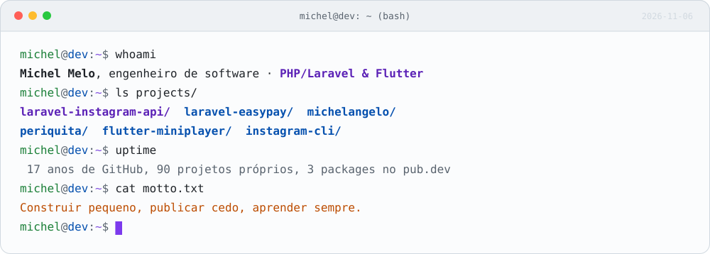
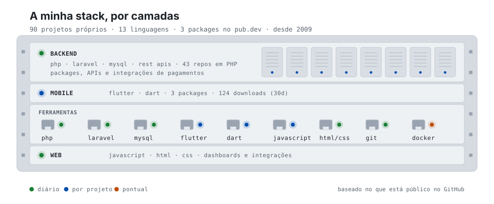
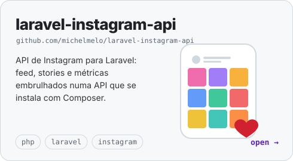
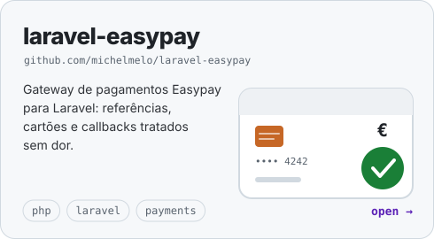
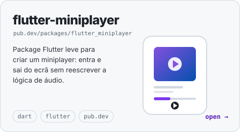
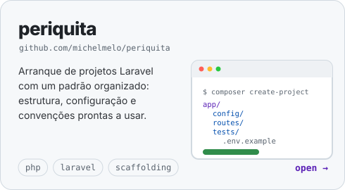
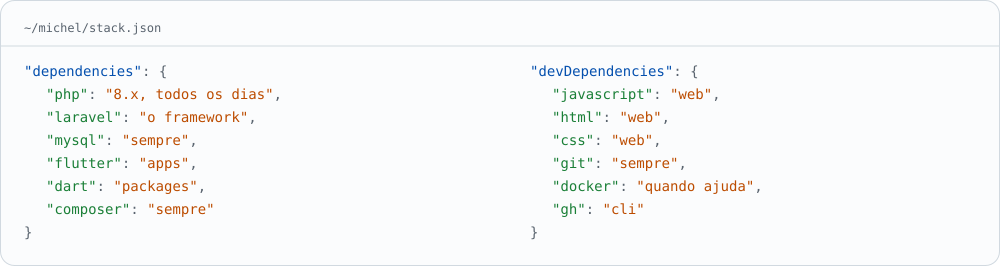

<picture>
  <source media="(prefers-color-scheme: dark)" srcset="assets/terminal-dark.svg">
  
</picture>

olá, sou o Michel. Sou engenheiro de software em Portugal e passo os dias a construir coisas web e mobile — **PHP/Laravel** no backend, **Flutter** quando o projeto pede uma app. Tenho uma queda por packages pequenos: se uma integração dá trabalho uma vez, o objetivo é que a próxima pessoa (ou eu, daqui a seis meses) não volte a sofrer com ela.

Vivo em Portugal e mantenho quase tudo o que faço em público. O código está no GitHub e os packages no Packagist e no pub.dev.

**[michelmelo.pt](https://www.michelmelo.pt)** &nbsp;·&nbsp; **[GitHub](https://github.com/michelmelo)** &nbsp;·&nbsp; **[X @machelmelo](https://twitter.com/machelmelo)**

 

<a href="https://github.com/michelmelo">
  <picture>
    <source media="(prefers-color-scheme: dark)" srcset="assets/packages-dark.svg">
    
  </picture>
</a>

Entre os packages que mantenho estão o **laravel-instagram-api** (Instagram no Laravel), o **laravel-easypay** (pagamentos Easypay), o **michelangelo** (gestão de imagens) e o **periquita** (arranque de projetos com um padrão organizado). Do lado mobile, o **flutter-miniplayer** e o **flutter_imagecards** estão publicados no pub.dev. Há ainda o **recrutador**, um bot da comunidade Laravel Portugal que recolhe e publica oportunidades, e o **instagram-cli**, uma ferramenta de linha de comandos para o Instagram.

 

<picture>
  <source media="(prefers-color-scheme: dark)" srcset="assets/stackrack-dark.svg">
  
</picture>

### Outras coisas que construí

  <a href="https://github.com/michelmelo/laravel-instagram-api"><picture><source media="(prefers-color-scheme: dark)" srcset="assets/tile-instagram-dark.svg"></picture></a>
  <a href="https://github.com/michelmelo/laravel-easypay"><picture><source media="(prefers-color-scheme: dark)" srcset="assets/tile-easypay-dark.svg"></picture></a>

  <a href="https://pub.dev/packages/flutter_miniplayer"><picture><source media="(prefers-color-scheme: dark)" srcset="assets/tile-miniplayer-dark.svg"></picture></a>
  <a href="https://github.com/michelmelo/periquita"><picture><source media="(prefers-color-scheme: dark)" srcset="assets/tile-periquita-dark.svg"></picture></a>

### O que uso no dia a dia

<picture>
  <source media="(prefers-color-scheme: dark)" srcset="assets/stack-dark.svg">
  
</picture>

### A minha semana, itemizada

  <picture>
    <source media="(prefers-color-scheme: dark)" srcset="assets/receipt-dark.svg">
    
  </picture>

Portugal &nbsp;·&nbsp; PHP/Laravel &amp; Flutter &nbsp;·&nbsp; cada gráfico aqui é um SVG gerado por <a href="scripts/generate.mjs">um script Node</a>

